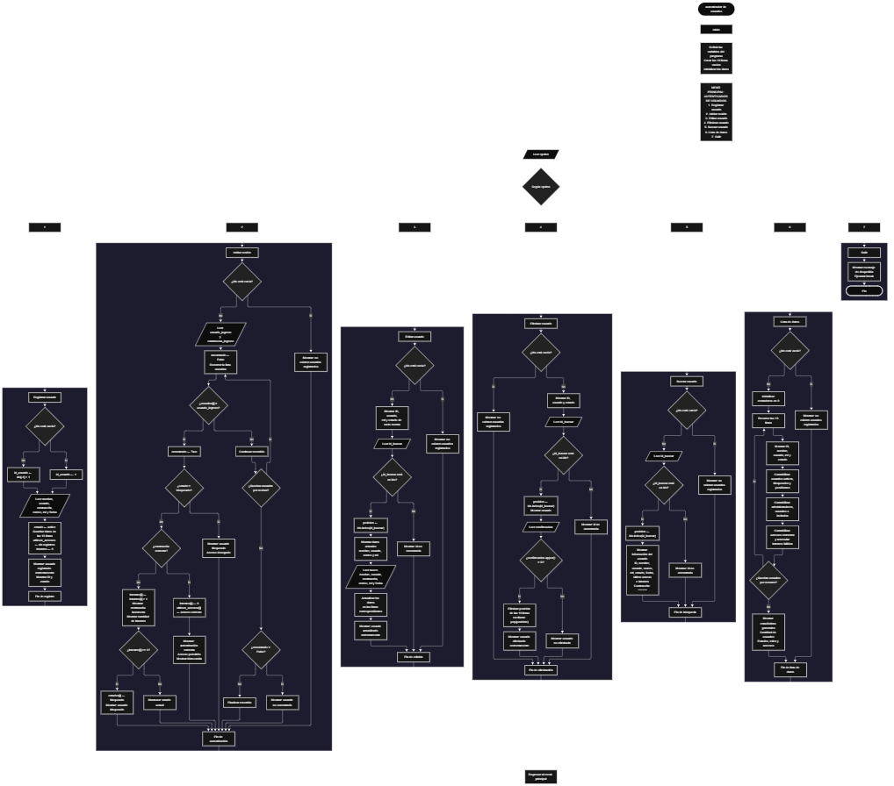

Este proyecto, llamado <b>autenticador de usuarios</b>, fue desarrollado en <b>python</b> como un ejercicio práctico para fortalecer la lógica de programación mediante la creación de un sistema de autenticación y gestión de usuarios desde la consola. El programa cuenta con un menú principal de siete opciones que permite <b>registrar, iniciar sesión, editar, eliminar, buscar y consultar los datos</b> de los usuarios registrados. Cada usuario almacena información como el nombre, nombre de usuario, contraseña, correo electrónico, rol, estado, fecha de registro, último acceso e intentos fallidos, utilizando diez listas relacionadas para organizar los datos durante la ejecución. Además, incorpora un sistema de autenticación que verifica las credenciales, controla los intentos fallidos y bloquea automáticamente las cuentas después de tres intentos incorrectos. Durante su desarrollo se aplicaron conceptos fundamentales de programación, como variables, listas, estructuras condicionales, ciclos repetitivos, operadores y métodos para administrar registros. Este proyecto permite poner en práctica los conocimientos adquiridos en <b>python</b> y sirve como base para desarrollar sistemas de autenticación y gestión de usuarios más avanzados.

<h2 align="center">⚙️ Funcionamiento del menú principal</h2>

### ➕ Registrar usuario

La opción <b>1) registrar usuario</b> permite incorporar un nuevo usuario al sistema. Antes de realizar el registro, el programa comprueba si existen usuarios almacenados mediante la función <b>len(ids)</b>. Si la lista está vacía, asigna el identificador inicial con el valor <b>1</b>. En caso contrario, genera un nuevo identificador sumando uno al último ID registrado mediante la expresión <b>ids[-1] + 1</b>. Después, solicita el <b>nombre, usuario, contraseña, correo, rol y fecha de registro</b>. El estado inicial se establece automáticamente como <b>"activo"</b>. Los datos se almacenan en sus respectivas listas utilizando el método <b>append()</b>. Además, registra el último acceso con el valor <b>"sin registros"</b> y establece los intentos fallidos en <b>0</b>. Finalmente, muestra el mensaje <b>"usuario registrado correctamente."</b>, junto con el ID y el estado asignado.

### 🔐 Iniciar sesión

La opción <b>2) iniciar sesión</b> permite comprobar las credenciales de un usuario registrado. Primero, el programa verifica si existen usuarios almacenados mediante la función <b>len(ids)</b>. Si no hay registros, muestra el mensaje <b>"no existen usuarios registrados."</b>. En caso contrario, solicita el nombre de usuario y la contraseña. Después, inicializa la variable lógica <b>encontrado</b> con el valor <b>False</b> y utiliza un ciclo <b>for</b> para recorrer la lista <b>usuarios</b>, comparando cada registro con el nombre de usuario introducido. Cuando encuentra una coincidencia, cambia la variable <b>encontrado</b> a <b>True</b> y comprueba el estado de la cuenta mediante <b>estados[i].lower()</b>. Si el usuario está bloqueado, muestra los mensajes <b>"usuario bloqueado."</b> y <b>"acceso denegado."</b>. Si la cuenta no está bloqueada, compara la contraseña almacenada con la contraseña introducida. Cuando ambas coinciden, reinicia los intentos fallidos a <b>0</b>, actualiza el último acceso con <b>"acceso correcto"</b> y muestra los mensajes <b>"autenticación correcta."</b>, <b>"acceso permitido."</b> y un mensaje de bienvenida con el nombre del usuario. Si la contraseña es incorrecta, aumenta en uno la cantidad de intentos mediante <b>intentos[i] += 1</b> y muestra el número de intentos realizados. Cuando alcanza los <b>3 intentos fallidos</b>, cambia el estado del usuario a <b>"bloqueado"</b> e informa que la cuenta fue bloqueada por demasiados intentos. Si termina el recorrido sin encontrar el nombre de usuario, muestra el mensaje <b>"usuario no encontrado."</b>.

### ✏️ Editar usuario

La opción <b>3) editar usuario</b> permite modificar la información de un usuario registrado. Primero, el programa comprueba si existen usuarios almacenados mediante la función <b>len(ids)</b>. Si no hay registros, muestra el mensaje <b>"no existen usuarios registrados."</b>. En caso contrario, utiliza un ciclo <b>for</b> para presentar una lista con el ID, nombre de usuario, rol y estado de cada registro. Después, solicita el ID del usuario que se desea editar y comprueba si existe mediante la condición <b>id_buscar in ids</b>. Si el identificador es válido, utiliza el método <b>index()</b> para obtener la posición correspondiente dentro de las listas. A continuación, muestra los datos actuales del usuario: <b>nombre, usuario, correo y rol</b>. Después, solicita la nueva información para actualizar el <b>nombre, usuario, contraseña, correo, rol y fecha de registro</b>, modificando directamente los valores almacenados en sus respectivas listas. Finalmente, presenta el mensaje <b>"usuario actualizado correctamente."</b>. Si el ID introducido no corresponde a ningún registro, muestra el mensaje <b>"id no encontrada."</b>.

### 🗑️ Eliminar usuario

La opción <b>4) eliminar usuario</b> permite eliminar un registro del sistema mediante su identificador. Antes de comenzar, el programa comprueba si existen usuarios almacenados. Si no hay registros, muestra el mensaje <b>"no existen usuarios registrados."</b>. Si hay usuarios disponibles, utiliza un ciclo <b>for</b> para presentar una lista con el ID, nombre de usuario y estado de cada cuenta. Después, solicita el ID del usuario que se desea eliminar y verifica si existe mediante la condición <b>id_buscar in ids</b>. Si el identificador es válido, utiliza el método <b>index()</b> para localizar su posición y muestra el nombre de usuario correspondiente. A continuación, solicita una confirmación mediante la variable <b>confirmacion</b>. Si el usuario introduce la letra <b>"S"</b>, comprobada mediante <b>confirmacion.upper() == "S"</b>, el programa elimina los datos de todas las listas utilizando el método <b>pop(posicion)</b>. Esta operación se realiza sobre las diez listas: <b>ids, nombres, usuarios, contrasenas, correos, roles, estados, fechas, ultimos_accesos e intentos</b>, manteniendo la información organizada en las mismas posiciones. Finalmente, muestra el mensaje <b>"usuario eliminado correctamente."</b>. Si la confirmación no es afirmativa, presenta el mensaje <b>"usuario no eliminado."</b>. Si el ID no existe, informa que el identificador no fue encontrado.

### 🔎 Buscar usuario

La opción <b>5) buscar usuario</b> permite consultar la información de un usuario mediante su identificador. Primero, el programa comprueba si existen registros almacenados. Si no hay usuarios, muestra el mensaje <b>"no existen usuarios registrados."</b>. En caso contrario, solicita el ID del usuario que se desea buscar y comprueba si se encuentra en la lista <b>ids</b>. Cuando el identificador existe, utiliza el método <b>index()</b> para obtener la posición del registro y muestra su información completa: <b>ID, nombre, usuario, contraseña protegida visualmente, correo, rol, estado, fecha de registro, último acceso e intentos fallidos</b>. Para evitar mostrar directamente la contraseña almacenada, utiliza el texto <b>"********"</b> como representación visual. Si el ID introducido no corresponde a ningún usuario registrado, presenta el mensaje <b>"id no encontrada."</b>.

### 📋 Lista de datos

La opción <b>6) lista de datos</b> permite visualizar los usuarios registrados y obtener estadísticas generales del sistema. Primero, el programa comprueba si existen registros mediante la función <b>len(ids)</b>. Si no hay usuarios almacenados, muestra el mensaje <b>"no existen usuarios registrados."</b>. En caso contrario, inicializa diferentes contadores para clasificar los usuarios según su estado, rol y actividad de acceso. Después, utiliza un ciclo <b>for</b> para recorrer las listas y mostrar el ID, nombre, usuario, rol y estado de cada cuenta. Durante el recorrido, incrementa los contadores de <b>usuarios activos, bloqueados y pendientes</b>, utilizando estructuras condicionales para comprobar el estado de cada registro. También contabiliza los roles de <b>administrador, usuario e invitado</b>. Finalmente, comprueba los últimos accesos para contabilizar los accesos correctos y acumula los intentos fallidos registrados en la lista <b>intentos</b>. Al terminar, presenta las estadísticas generales, incluyendo la cantidad total de usuarios registrados, la clasificación por estados, los roles y los accesos correctos e intentos fallidos.

### 🚪 Salir del menú principal

La opción <b>7) salir</b> permite finalizar la ejecución del programa. Cuando el usuario selecciona esta opción, el programa muestra el mensaje <b>"gracias por utilizar el autenticador de usuarios."</b> y ejecuta la instrucción <b>break</b>, que interrumpe el ciclo <b>while</b> y finaliza el menú principal. Si el usuario introduce un valor diferente a las opciones establecidas, el programa ejecuta la condición <b>else</b> y muestra el mensaje <b>"opción no válida."</b>.

<h2 align="center">🧠 Temas aplicados en el proyecto</h2>

### 📦 Variables

En este proyecto se utilizan variables para almacenar temporalmente la información introducida por el usuario, controlar las opciones del menú, generar identificadores, localizar registros, administrar los intentos de autenticación y realizar el seguimiento de los usuarios. Cada variable cumple una función específica dentro de las operaciones de registro, inicio de sesión, edición, eliminación, búsqueda y consulta de estadísticas.

🔢 **Opcion:** Almacena la opción seleccionada por el usuario en el menú principal.

🆔 **Id_usuario:** Almacena el identificador generado para cada nuevo usuario.

📝 **Nombre:** Almacena el nombre de la persona que se registra o actualiza su información.

👤 **Usuario:** Almacena el nombre de usuario utilizado para iniciar sesión.

🔐 **Contrasena:** Almacena la contraseña del usuario registrado.

📧 **Correo:** Almacena la dirección de correo electrónico del usuario.

🎭 **Rol:** Almacena el tipo de rol asignado a cada cuenta.

📅 **Fecha:** Almacena la fecha de registro del usuario.

🔎 **Usuario_ingreso:** Almacena el nombre de usuario introducido durante la autenticación.

🔑 **Contrasena_ingreso:** Almacena la contraseña introducida para comprobar las credenciales.

🔍 **Encontrado:** Variable lógica que indica si se encontró el usuario solicitado.

🆔 **Id_buscar:** Almacena el identificador introducido para localizar un usuario.

📍 **Posicion:** Almacena el índice correspondiente al usuario localizado en las listas.

✅ **Confirmacion:** Almacena la respuesta del usuario antes de realizar una eliminación.

📊 **Activos, bloqueados y pendientes:** Contadores utilizados para clasificar los usuarios según su estado.

🎭 **Administradores, usuarios_normales e invitados:** Contadores utilizados para clasificar los roles registrados.

🔐 **Accesos_correctos y accesos_fallidos:** Variables utilizadas para contabilizar los accesos correctos y los intentos fallidos.

### 🗃️ Listas

En este proyecto se utilizan diez listas relacionadas para almacenar la información de los usuarios registrados. Todas trabajan mediante el mismo índice, lo que permite mantener organizados los datos correspondientes a cada persona. Por ejemplo, la información de un usuario ubicado en la posición <b>0</b> se encuentra distribuida entre <b>ids[0], nombres[0], usuarios[0], contrasenas[0], correos[0], roles[0], estados[0], fechas[0], ultimos_accesos[0] e intentos[0]</b>. Esta organización permite recorrer, buscar, modificar, consultar y eliminar los registros de manera coordinada durante la ejecución del programa.

🆔 **Ids:** Almacena los identificadores únicos asignados a los usuarios.

📝 **Nombres:** Almacena los nombres de las personas registradas.

👤 **Usuarios:** Almacena los nombres de usuario utilizados para la autenticación.

🔐 **Contrasenas:** Almacena las contraseñas correspondientes a cada cuenta.

📧 **Correos:** Almacena las direcciones de correo electrónico.

🎭 **Roles:** Almacena los roles asignados a los usuarios.

📊 **Estados:** Almacena el estado actual de cada cuenta, como activo o bloqueado.

📅 **Fechas:** Almacena las fechas de registro de los usuarios.

🔄 **Ultimos_accesos:** Almacena el resultado del último acceso registrado.

🔢 **Intentos:** Almacena la cantidad de intentos fallidos de autenticación.

### 🔀 Estructuras condicionales

En este proyecto se utilizan las estructuras <b>if, elif y else</b> para controlar las diferentes operaciones del programa. Estas condiciones permiten comprobar si existen usuarios registrados, verificar si un identificador se encuentra en la lista correspondiente, determinar si las credenciales introducidas son correctas, comprobar el estado de una cuenta, controlar los intentos fallidos y validar la confirmación antes de eliminar un usuario. También permiten clasificar los registros según sus estados y roles, así como ejecutar el mensaje correspondiente cuando se introduce una opción que no pertenece al menú principal.

### 🔄 Estructuras repetitivas

En este proyecto se utilizan los ciclos <b>while</b> y <b>for</b> para controlar la ejecución del programa y recorrer las listas de usuarios. El ciclo <b>while True</b> mantiene activo el menú principal y permite ejecutar diferentes operaciones hasta que se selecciona la opción de salida, momento en el que se utiliza la instrucción <b>break</b> para finalizar el ciclo. Por otro lado, los ciclos <b>for</b> permiten recorrer los registros almacenados, mostrar los usuarios, buscar coincidencias durante la autenticación y obtener las estadísticas generales del sistema.

### 🔢 Métodos y funciones de listas

El programa utiliza diferentes métodos y funciones de Python para administrar la información almacenada. El método <b>append()</b> permite agregar nuevos datos al final de las listas durante el registro de usuarios. El método <b>pop()</b> elimina los elementos de una posición específica durante la eliminación de una cuenta. El método <b>index()</b> permite localizar la posición de un identificador dentro de la lista <b>ids</b>. Por otra parte, la función <b>len()</b> permite conocer la cantidad de elementos almacenados y comprobar si existen usuarios registrados. Estas herramientas facilitan la administración de los registros sin necesidad de utilizar estructuras de almacenamiento más avanzadas.

### 🔠 Métodos de cadenas

En este proyecto se utilizan los métodos <b>lower()</b> y <b>upper()</b> para trabajar con los textos introducidos y almacenados. El método <b>lower()</b> convierte el contenido de una cadena a minúsculas y se utiliza para comprobar el estado de las cuentas sin depender de las diferencias entre letras mayúsculas y minúsculas. Por otro lado, el método <b>upper()</b> convierte el texto de confirmación a mayúsculas, permitiendo aceptar la letra <b>"S"</b> aunque el usuario la introduzca en minúscula.

### 🔗 Relación entre listas

Las diez listas utilizadas en el proyecto mantienen una relación mediante sus posiciones o índices. Cada posición representa un usuario y contiene sus respectivos datos distribuidos entre las listas. Durante el registro, el método <b>append()</b> agrega los valores correspondientes en cada una. Durante la edición, los elementos de la posición seleccionada se actualizan directamente. Durante la eliminación, el método <b>pop(posicion)</b> retira los datos de todas las listas en el mismo índice. Esta organización permite conservar la correspondencia entre la información de cada usuario y mantener los registros coordinados.

<h2 align="center">¿Cómo se implementaron las operaciones crud en el proyecto?</h2>

Las operaciones <b>crud</b> se implementaron mediante las opciones del menú principal, permitiendo administrar los usuarios registrados. La operación <b>crear</b> corresponde a <b>registrar usuario</b>, donde se solicitan los datos de una nueva cuenta y se almacenan en las listas correspondientes; <b>leer</b> se realiza mediante las opciones <b>buscar usuario y lista de datos</b>, que permiten consultar la información individual y visualizar los registros existentes; <b>actualizar</b> corresponde a <b>editar usuario</b>, donde se modifican los datos de una cuenta registrada; y <b>eliminar</b> se realiza mediante la opción <b>eliminar usuario</b>, que retira la información de las diez listas relacionadas. Estas operaciones utilizan variables, listas, condicionales, ciclos y métodos de Python para administrar la información almacenada temporalmente durante la ejecución del programa.

<h2 align="center">Diagrama de flujo del proyecto</h2>

<h2 align="center">🛡️ Validaciones del programa</h2>

### 📭 No existen usuarios registrados

Esta validación se utiliza en las opciones de <b>iniciar sesión, editar, eliminar, buscar y lista de datos</b>. El programa comprueba si la lista <b>ids</b> está vacía mediante la condición <b>len(ids) == 0</b>. Si no existen usuarios registrados, muestra el mensaje <b>"no existen usuarios registrados."</b>. Esta comprobación evita continuar con las operaciones que necesitan información almacenada cuando todavía no hay cuentas creadas.

### ❌ Usuario no encontrado

Esta validación se utiliza durante el inicio de sesión cuando el nombre de usuario introducido no coincide con ninguno de los registros almacenados. Para realizar la comprobación, el programa inicializa la variable lógica <b>encontrado</b> con el valor <b>False</b> y recorre la lista <b>usuarios</b> mediante un ciclo <b>for</b>. Cuando encuentra una coincidencia, cambia la variable a <b>True</b>. Si finaliza el recorrido sin encontrar el usuario, muestra el mensaje <b>"usuario no encontrado."</b>. En las operaciones de edición, eliminación y búsqueda, también se comprueba que el ID introducido exista dentro de la lista <b>ids</b>. Si no existe, se presenta el mensaje <b>"id no encontrada."</b>.

### 🔐 Contraseña incorrecta

Esta validación se utiliza durante el inicio de sesión cuando el nombre de usuario existe, pero la contraseña introducida no coincide con la almacenada. El programa aumenta el contador correspondiente mediante la instrucción <b>intentos[i] += 1</b> y muestra el mensaje <b>"contraseña incorrecta."</b>. También presenta la cantidad de intentos realizados mediante la variable <b>intentos[i]</b>. Esta comprobación permite llevar el control de los errores cometidos durante la autenticación.

### 🔒 Bloqueo por intentos fallidos

Esta validación se utiliza para impedir el acceso a una cuenta cuando se alcanza la cantidad máxima de intentos incorrectos establecida en el programa. Después de cada contraseña incorrecta, el sistema comprueba si la variable <b>intentos[i] >= 3</b>. Cuando se cumple esta condición, modifica el estado de la cuenta a <b>"bloqueado"</b> y muestra el mensaje <b>"usuario bloqueado por demasiados intentos."</b>. De esta manera, el usuario no puede continuar intentando iniciar sesión mientras su cuenta permanezca bloqueada.

### 🚫 Acceso denegado a usuarios bloqueados

Esta validación se realiza durante el inicio de sesión antes de comprobar la contraseña. El programa verifica si el estado del usuario es igual a <b>"bloqueado"</b> mediante la condición <b>estados[i].lower() == "bloqueado"</b>. Si la cuenta se encuentra bloqueada, muestra los mensajes <b>"usuario bloqueado."</b> y <b>"acceso denegado."</b>, impidiendo continuar con el proceso de autenticación. Esta comprobación permite controlar el acceso de las cuentas que han superado los tres intentos fallidos.

### 🔄 Reinicio de intentos fallidos

Esta validación se aplica cuando un usuario introduce correctamente sus credenciales. Después de comprobar que la contraseña coincide con la almacenada, el programa restablece el contador correspondiente mediante la instrucción <b>intentos[i] = 0</b>. También actualiza el último acceso con el valor <b>"acceso correcto"</b>. De esta manera, el sistema mantiene actualizado el resultado de la autenticación y reinicia el contador de intentos fallidos después de un acceso correcto.

### ⚠️ Confirmación de eliminación

Esta validación se utiliza antes de eliminar un usuario registrado. Después de localizar la cuenta mediante su ID, el programa solicita una confirmación utilizando la variable <b>confirmacion</b>. La respuesta se convierte a mayúsculas mediante el método <b>upper()</b> y se comprueba con la condición <b>confirmacion.upper() == "S"</b>. Si el usuario confirma la operación, el programa elimina los datos correspondientes de las diez listas. En caso contrario, muestra el mensaje <b>"usuario no eliminado."</b>, evitando realizar la eliminación sin una respuesta afirmativa.

### 🔢 Identificador de usuario

El programa utiliza la lista <b>ids</b> para identificar cada cuenta registrada mediante un número consecutivo. Cuando se registra el primer usuario, se asigna el identificador <b>1</b>. Para los siguientes registros, se obtiene el último identificador almacenado mediante <b>ids[-1]</b> y se suma uno. Esta forma de generar identificadores permite distinguir los registros y localizar la información correspondiente durante las operaciones de edición, eliminación y búsqueda.

### ⚠️ Opción inválida

El menú principal utiliza una estructura condicional compuesta por <b>if, elif y else</b> para identificar la opción seleccionada. Cuando el usuario introduce un valor que no corresponde a ninguna de las siete opciones establecidas, se ejecuta el bloque <b>else</b> y se muestra el mensaje <b>"opción no válida."</b>. Esta validación permite informar al usuario cuando introduce una selección que no se encuentra disponible en el menú.

<h2 align="center">🎯 Objetivo del proyecto</h2>

El objetivo principal de este proyecto es fortalecer la <b>lógica de programación</b> mediante el desarrollo de un sistema de autenticación y gestión de usuarios en <b>python</b>. A través de su construcción se busca aplicar los conocimientos adquiridos sobre variables, listas, estructuras condicionales, ciclos repetitivos y métodos de manipulación de datos, integrándolos para resolver un problema de manera organizada. Además, el proyecto permite comprender cómo registrar, autenticar, consultar, modificar y eliminar usuarios, así como implementar controles básicos de acceso mediante la verificación de credenciales y el bloqueo de cuentas por intentos fallidos.

